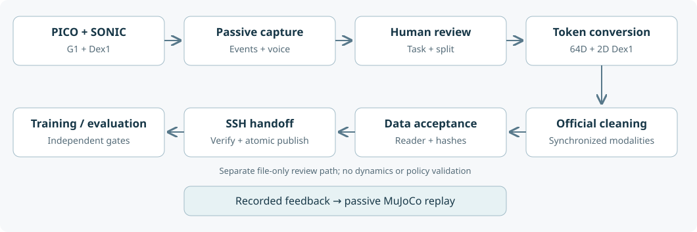

# G1 SONIC Workstation

**PICO teleoperation · Dex1 grippers · spoken capture feedback · auditable datasets · passive real2sim replay**

[中文说明](README.zh-CN.md) · [Setup](docs/SETUP.zh-CN.md) · [Workflow](docs/WORKFLOW.zh-CN.md) · [Pitfalls](docs/PITFALLS.zh-CN.md) · [Validation](docs/VALIDATION.md)

A practical integration layer built while bringing up a Unitree G1 with NVIDIA SONIC. It shares the adapters, workstation UI, recording tools and lessons needed between the official tutorials and a usable collection workflow. It is a community project, independent of NVIDIA and Unitree.

The contribution is the integration: explicit physical left/right Dex1 routing, bounded PICO input freshness, a USB binocular head camera plus two D405 wrists, asynchronous Chinese speech through the G1 speaker, episode/batch management, measured-state replay, and a fail-closed data preparation pipeline.

| Directory | What it contains |
|---|---|
| `capture/` | Passive ZMQ/DDS recording, raw evidence, batches, quality checks and voice |
| `sonic_pipeline/` | Human review, monotonic as-of token conversion, official cleaning, dataset acceptance, handoff and training gates |
| `wbc/official_sonic/` | Overlay for SONIC workstation UI, PICO/Dex1 orchestration, cameras and diagnostics |
| `wbc/offline_replay/` | File-only measured 29D body + 2D gripper replay; no physics stepping |
| `wbc/sim_teleop/` | Separate isolated teleoperation simulation tooling |
| `patches/` | Ten tracked source fixes against a pinned WBC commit |
| `references/` | Exact versions, source hashes, voice and replay-asset provenance |

## Start here

1. Read [setup](docs/SETUP.zh-CN.md). Use separate pinned upstream clones; retain their official environments and licenses.
2. Run `python3 tools/prepare.py --help`. It prepares a **read-only plan by default**; `--apply` copies reviewed sources into a new workspace and a clean WBC checkout. It does not install packages or start hardware.
3. Run the offline commands in [validation](docs/VALIDATION.md), then commission your camera roles, network and gripper mapping.
4. Follow [the complete workflow](docs/WORKFLOW.zh-CN.md). Formal processing remains blocked until the site owner reviews a local policy and creates its hash lock.

## Scope and current limits

This is a source release of an existing integration, not a plug-and-play validated robot distribution. Original-site regression results and release checks are recorded separately. No real episodes, images of operators, checkpoints, credentials, internal server endpoints or runtime caches are included.

**real2sim currently means passive kinematic replay of recorded robot feedback.** It does not establish contact dynamics, grasp success, a trained policy, or deployment readiness. Third-party Dex1 mesh/model assets with unclear redistribution terms are excluded; provenance and a local builder are provided. Hardware commissioning and new-machine acceptance remain required.

The 50 Hz action grid is not camera exposure rate or proof of sensor-clock synchronization. Engineering data and smoke checkpoints cannot pass formal training gates.

## Attribution and reuse

Original project code is Apache-2.0; see [LICENSE](LICENSE). Upstream components retain their own licenses and notices in [THIRD_PARTY_NOTICES.md](THIRD_PARTY_NOTICES.md). SONIC weights, reference meshes and voice models are separate downloads under their respective terms.
